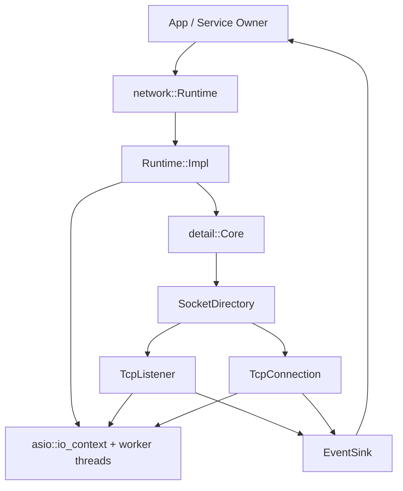
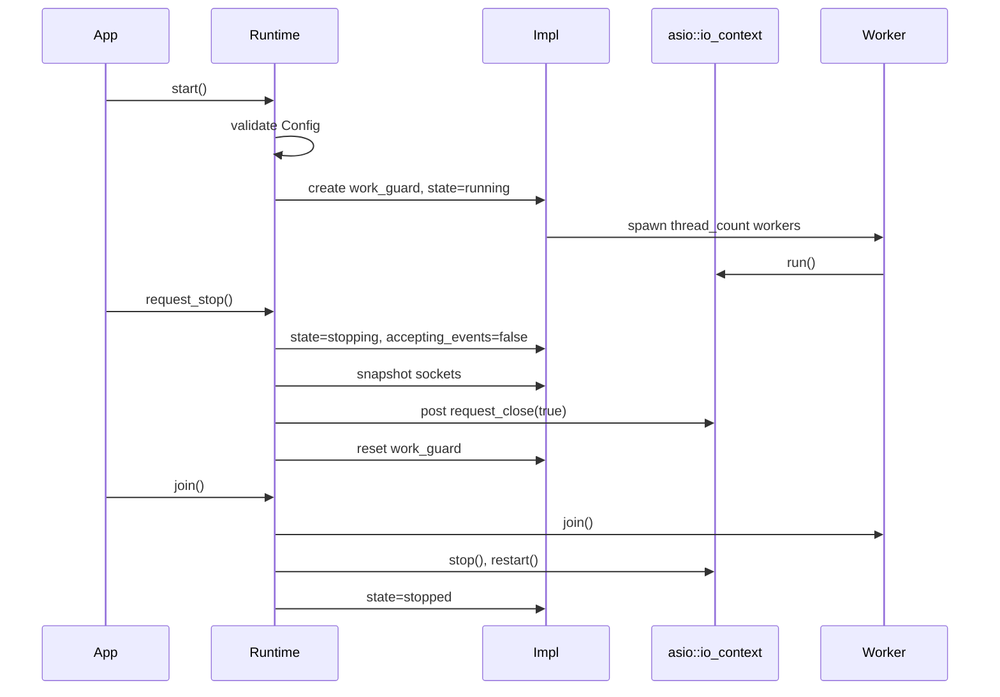
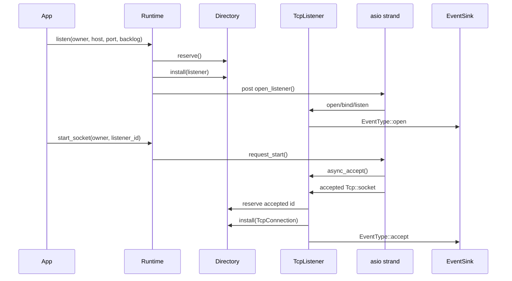
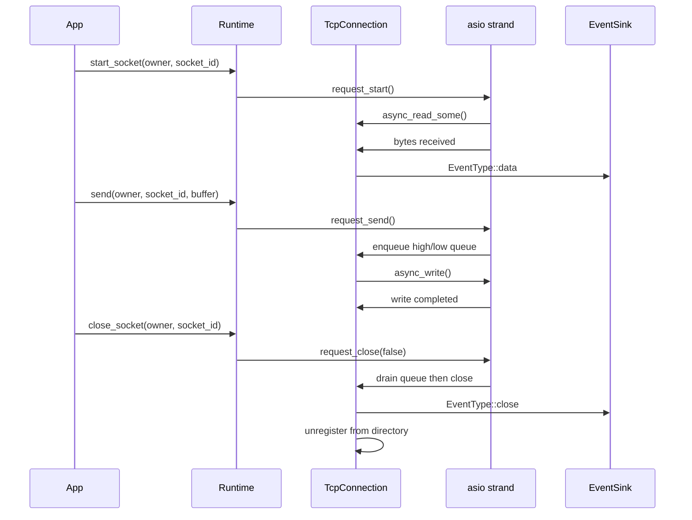
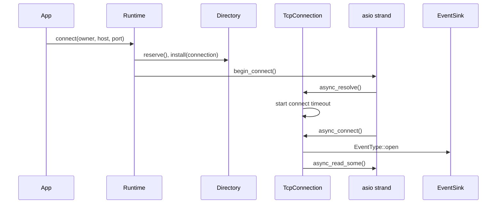

# Network 设计架构

## 当前能力边界

`skynet_network` 是基于 standalone Asio 的 C++23 静态库，公开入口在
`include/skynet/network/runtime.hpp`。当前可用能力是 TCP 监听、出站连接、
异步收发、暂停/恢复读、优雅关闭和强制关闭。UDP 相关类型与 API 已预留，
但 `Runtime::udp_bind`、`Runtime::udp_connect`、`Runtime::udp_send` 当前返回
未实现错误，不应被业务依赖。

网络层不直接调用业务对象。所有 socket 事件通过 `EventSink::publish(Event&&)`
上报给 runtime owner，由上层决定如何路由到服务或 app。

## 架构分层

- `Runtime`：唯一公开门面，负责生命周期、参数校验、socket owner 校验和
  socket 操作转发。
- `Runtime::Impl`：持有 `asio::io_context`、work guard、worker thread、
  lifecycle mutex 与运行状态。
- `Core`：网络内部共享上下文，保存配置、事件出口和 socket directory。
- `SocketDirectory`：分配 `SocketId`，维护 id 到 socket 对象的映射。
- `SocketBase`：TCP listener/connection 的共同基类，封装 owner、strand、
  close-once 事件和错误发布。
- `TcpListener`：打开监听端口，接收连接并为 accepted socket 分配新 id。
- `TcpConnection`：处理 DNS resolve、connect、read、write queue、close。

## 核心流程时序

### Runtime 启停

### TCP Listen / Accept

### TCP Read / Write / Close

### TCP 出站连接

## 事件语义

- `open`：listener 成功监听，或 outbound connection 建连成功。
- `accept`：listener 接收到新 TCP 连接，`accepted_socket` 是新连接 id。
- `data`：TCP connection 收到数据，`payload` 保存本次读取内容。
- `warning`：connection 发送队列超过 `Config::write_warning_bytes`。
- `error`：异步操作失败或参数相关错误，错误文本在 `Event::text`。
- `close`：socket 已关闭且已从 directory 移除。runtime 整体停止时会关闭 socket，
  但会关闭事件出口以抑制停止过程中的后续事件。

## 维护细则

- 所有 socket 内部状态只能在各自 strand 上修改。公开 API 只做校验和投递，
  不直接操作 Asio socket。
- `EventSink::publish` 必须是非阻塞、`noexcept` 语义友好的实现；需要复杂逻辑时，
  先把事件入队，再由业务线程消费。
- 新增公开 API 时必须在 `Runtime` 做 owner、运行态和 socket kind 校验，错误用
  `std::expected` 返回，不新增异常式控制流。
- `SocketDirectory::reserve()` 与 `install()` 是两阶段流程。失败路径必须调用
  `erase()` 释放已预留 id。
- `close_socket()` 表示尽量排空发送队列后关闭；`shutdown_socket()` 与
  runtime 停止路径表示强制关闭。
- 发送队列需要维护 `queued_write_bytes_` 与 warning/hard limit。任何新增发送路径
  都必须复用同一套限流语义。
- 不要从业务线程直接持有或暴露 `detail::*` 类型；`detail` 命名空间只服务网络库内部。
- UDP API 在实现完成前只能作为保留接口记录在文档和错误处理中，测试和 app 不应使用。

## 验证要求

- 每次修改网络库后至少运行 `cmake --build --preset all-debug` 和
  `ctest --preset linux-debug --output-on-failure`。
- 修改 socket 生命周期、accept/read/write/close 流程时，需要增加覆盖成功路径和失败路径
  的测试或可运行 app 验证。
- 调整 public header 时，要确认 `skynet_network` 仍只公开必要 include 目录，
  不把 `src/network/detail.hpp` 当成业务可依赖接口。
